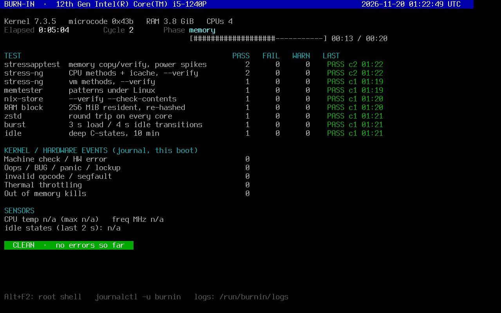
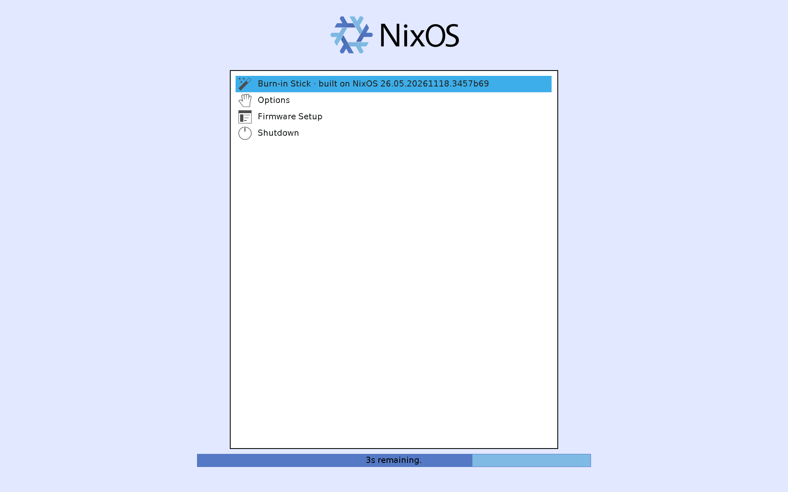
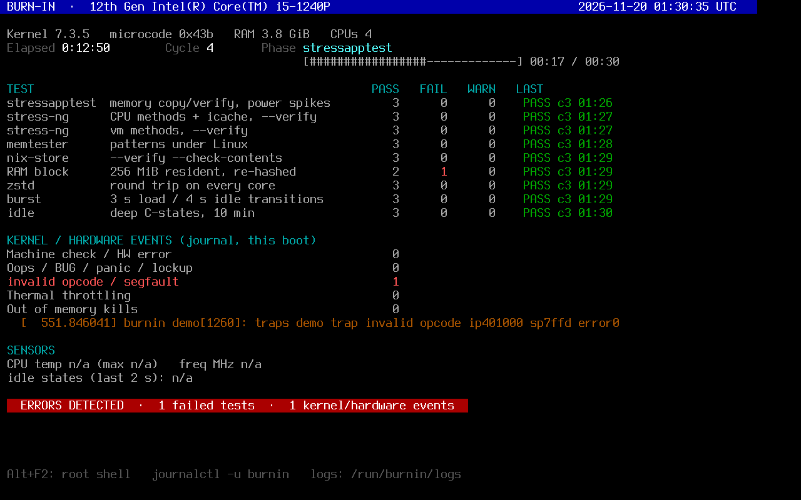
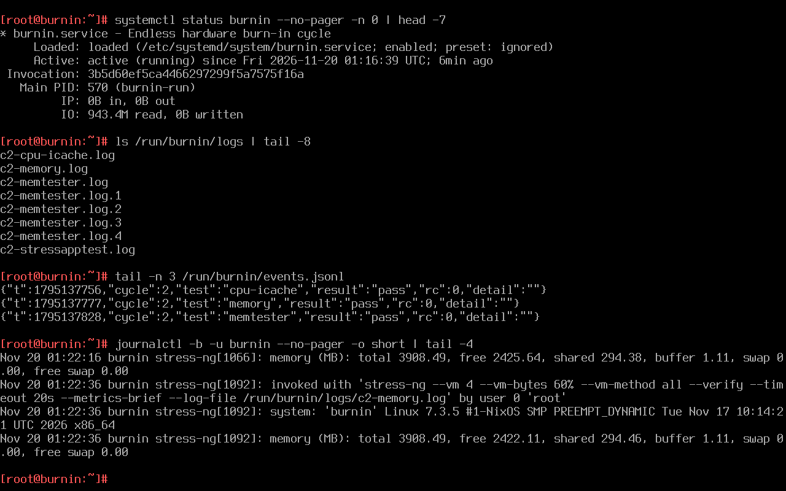

<div align="center">

# 🔥 burnin-stick

**A bootable USB stick that burns in x86_64 hardware.**<br>
An endless stress → verify cycle under the real Linux kernel, with a status screen you can read from across the room, like memtest.

[](https://nixos.org)
[](flake.nix)
[](#build-it-yourself)
[](#build-it-yourself)
[](#safety)
[](#safety)
[](LICENSE)

**[⬇ Prebuilt ISO, checksums and the full write-up → becker.koeln/ai/burnin-stick](https://becker.koeln/ai/burnin-stick/)**



</div>

---

## Why

memtest86+ runs at a fixed clock without the kernel's power management.
Faults that appear only under Linux, when CPUs drop into deep C-states
and change frequency, pass it. This stick runs the real kernel, puts the
machine under sustained load, and also switches between load and idle
on purpose.

It was built for a small router box that passed 40 hours of memtest and
still crashed under Linux with single-bit flips.

## Quick start

```sh
# grab the ISO from https://becker.koeln/ai/burnin-stick/  (or build it, see below)
sha256sum -c SHA256SUMS
lsblk                                        # find the stick, double-check
sudo dd if=burnin-stick.iso of=/dev/sdX bs=4M conv=fsync status=progress
```

Boot it, walk away, come back in 24–48 h. Green line: fine. Red line: it stays red.

## Screens

<table>
  <tr>
    <td width="50%"></td>
    <td width="50%"></td>
  </tr>
  <tr>
    <td><b>Boot menu.</b> UEFI and legacy BIOS. The burn-in starts on its own, no keyboard needed.</td>
    <td><b>Clean run.</b> Cycle, phase with progress bar, PASS/FAIL/WARN per test, journal event counters, sensors.</td>
  </tr>
  <tr>
    <td></td>
    <td></td>
  </tr>
  <tr>
    <td><b>Errors.</b> A changed RAM block (injected) and an invalid-opcode trap pulled from the journal. The line stays red.</td>
    <td><b>tty2.</b> Root shell: service status, per-phase logs in <code>/run/burnin/logs/</code>, the JSON event stream, the journal.</td>
  </tr>
</table>

<sub>Screenshots are from a QEMU test run, so the sensor lines read <code>n/a</code>; on real hardware they show temperature, per-core frequency and C-state residency.</sub>

## What one cycle does (~75 min, repeats forever)

| Phase | Tool | Catches |
|---|---|---|
| 🧠 stressapptest, 15 min | `stressapptest -W --cc_test`, a power spike every 2 min | bit flips under copy load, cache coherency across cores, load↔idle transitions |
| ⚙️ cpu-icache, 10 min | `stress-ng --cpu 0 --cpu-method all --icache N --verify` | wrong results, instruction-cache corruption |
| 🧮 memory, 10 min | `stress-ng --vm N --vm-bytes 60% --vm-method all --verify` | memory pattern errors under Linux |
| 🧪 memtester, ≤ 25 min | memtester, one instance per core, half the free RAM, one loop | classic patterns with power management active |
| 🔒 integrity | `nix-store --verify --check-contents`, a 256 MiB block kept in RAM and re-hashed every cycle, a zstd round trip on every core | flips in long-resident data and in cached program bytes |
| ⚡ burst, 10 min | 3 s `stress-ng --cpu` / 4 s idle | constant P-state/C-state transitions |
| 💤 idle, 10 min | `sleep` | deep C-states, like a server at night |

The results:

- **FAIL**: a tool reported a verification error, or a signal killed a stressor.
- **WARN**: a harness or resource problem (for example an allocation
  failure). It is not a verdict by itself, look at the log.
- A changed RAM block counts **once**, after which the new content
  becomes the reference (memtest semantics).

Kernel and hardware events are counted from the journal: machine checks
and EDAC, Oops/BUG/panic/lockups, invalid opcode/segfault/SIGILL,
thermal throttling, OOM kills. One FAIL or one such event turns the
status line red, and it stays red.

## The screen

- **tty1**: elapsed time, cycle and phase with a progress bar,
  PASS/FAIL/WARN per test, the journal event counters with the last
  matching lines, CPU temperature (session maximum), per-core frequency,
  idle-state residency, and the CLEAN / ERRORS line.
- **tty2** (Alt+F2): a root shell. Run `journalctl -u burnin -f`; the full
  output of every phase is in `/run/burnin/logs/`. `turbostat` and
  `sensors` are installed.

The console never blanks and `kernel.panic = 0`, so a panic or a hang
stays on the screen, the way a memtest error does.

## Safety

- 🔌 **No network.** No interface is configured, and there is no ssh.
- 💾 **The internal disks are never touched.** Nothing is mounted. Every
  test uses RAM and tmpfs only, and stressapptest runs without its disk
  threads.
- 🔑 Root has no password, on the local console only. Physical access is
  the trust model.
- 🌡️ The machine gets hot. That is the point. Watch the temperature line.

## Build it yourself

```sh
nix build github:devfbe/burnin-stick        # -> result/iso/burnin-stick.iso
lsblk                                        # find the stick, double-check
sudo dd if=result/iso/burnin-stick.iso of=/dev/sdX bs=4M conv=fsync status=progress
```

The ISO boots on UEFI and on legacy BIOS. The kernel is
`linuxPackages_latest`, with Intel and AMD microcode updates. The
`flake.lock` pins nixpkgs, so the build gives the same store path as the
prebuilt ISO on the download page.

To embed the burn-in in an image of your own, use the module:

```nix
{
  inputs.burnin-stick.url = "github:devfbe/burnin-stick";
  # ...
  modules = [ inputs.burnin-stick.nixosModules.default ];
}
```

For a quick functional check, set `BURNIN_SCALE=60` on `burnin.service`.
It divides every phase duration, so a whole cycle takes a few minutes.

## Files

| File | Purpose |
|---|---|
| `flake.nix` | ISO package and NixOS module |
| `burnin.nix` | the image: kernel, services, no network, console |
| `burnin-run.sh` | the test cycle; writes JSON events to `/run/burnin` |
| `dashboard.py` | the curses status screen on tty1 |

## Not included

- **mprime / Prime95**: its source fetch in nixpkgs 26.05 is broken upstream.
- **y-cruncher**: it needs AVX, which many of the low-power boxes this
  stick is meant for do not have.

## Found a broken box with it?

Open an issue with the label **hardware-report**: the board/CPU, how long
it ran, and a photo of the screen. False alarms are just as interesting,
label those **false-positive**.

## License

MIT for the code in this repository. The ISO contains free software
under its own licenses, plus CPU microcode that may be redistributed. The
corresponding source is this flake and its pinned `flake.lock`.

No warranty. Stress testing can expose, or finish off, marginal hardware.
